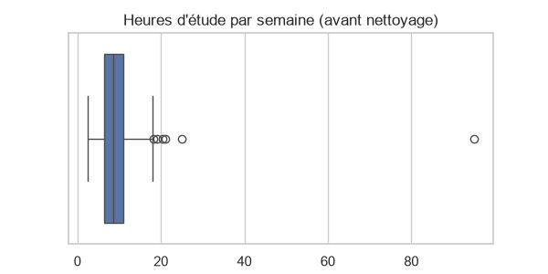
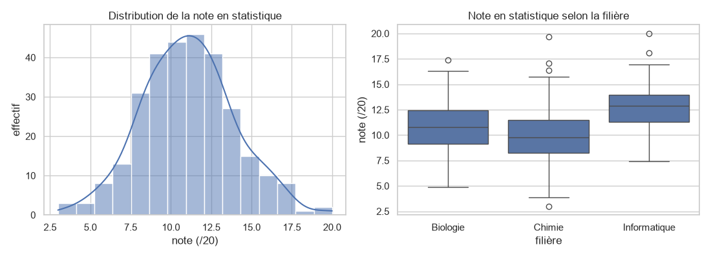
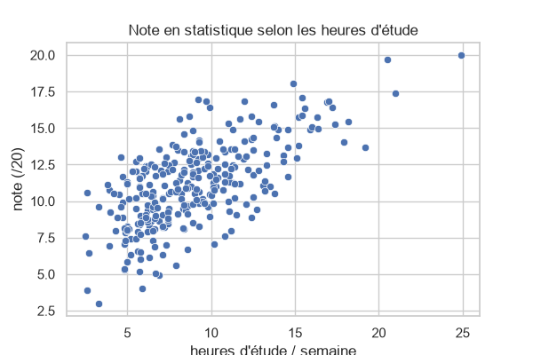
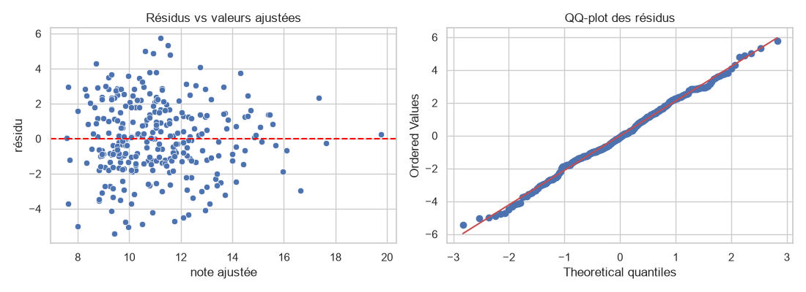
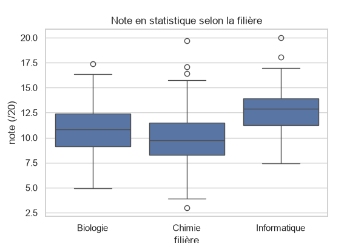

# Analyse statistique des notes des étudiants

Projet d'analyse de données réalisé en Python. Le programme étudie les performances d'étudiants en statistique à partir de données individuelles et applique plusieurs méthodes statistiques : statistiques descriptives, régression linéaire, ANOVA, tests du khi-deux et comparaison par paires.

## Contenu du projet

```text
.
|-- projet_etudiant.py          # Analyse statistique complète
|-- donnees_projet.csv          # Jeu de données des étudiants
|-- ENONCE_projet_complet.pdf   # Sujet du projet
|-- Rapport/                    # Figures utilisées dans le rapport
|-- README.md
```

## Objectifs

- Nettoyer les données et identifier les valeurs manquantes ou aberrantes.
- Décrire les variables quantitatives et qualitatives.
- Étudier la relation entre les heures d'étude et la note en statistique.
- Comparer les notes moyennes selon les filières.
- Tester l'association entre plusieurs variables catégorielles.
- Vérifier les conditions d'application des tests statistiques.
- Interpréter les résultats au seuil de significativité `alpha = 0.05`.

## Données

Le fichier `donnees_projet.csv` contient 300 étudiants et les variables suivantes :

| Variable | Description |
|---|---|
| `id` | Identifiant de l'étudiant |
| `filiere` | Filière d'études |
| `sexe` | Sexe |
| `logement` | Type de logement |
| `assiduite` | Niveau d'assiduité |
| `moyenne_bac` | Moyenne obtenue au baccalauréat |
| `heures_etude` | Nombre d'heures d'étude par semaine |
| `heures_sommeil` | Nombre d'heures de sommeil |
| `note_stat` | Note en statistique |
| `reussite` | Statut d'admission |

Les variables utilisées pour les analyses sont filtrées afin d'écarter les valeurs manquantes concernées. La valeur aberrante `95` dans `heures_etude` est remplacée par une valeur manquante et conservée comme `heures_etude_brut` pour garder une trace de la donnée d'origine.

## Prérequis

- Python 3.9 ou une version ultérieure
- Les bibliothèques suivantes :
  - pandas
  - numpy
  - scipy
  - matplotlib
  - seaborn

Installation des dépendances :

```bash
pip install pandas numpy scipy matplotlib seaborn
```

## Exécution

Depuis le dossier du projet :

```bash
python projet_etudiant.py
```

Le script affiche les tableaux et les résultats statistiques dans la console et ouvre les graphiques avec Matplotlib.

## Méthodes mises en œuvre

### 1. Nettoyage et analyse descriptive

Le script examine les dimensions du jeu de données, les types de variables, les valeurs manquantes et les statistiques de base. Il produit également un histogramme des notes et des boxplots.

### 2. Régression linéaire simple

Une régression de la note en statistique sur les heures d'étude est réalisée :

```text
note_stat = b0 + b1 * heures_etude
```

La sortie comprend :

- le coefficient de corrélation de Pearson ;
- les coefficients de régression ;
- le coefficient de détermination `R²` ;
- l'intervalle de confiance à 95 % de la pente ;
- les résidus et leurs graphiques ;
- le test de normalité de Shapiro-Wilk ;
- une prédiction pour 10 heures d'étude ;
- une régression multiple optionnelle avec la moyenne au bac.

### 3. ANOVA à un facteur

Le script compare la note en statistique entre les filières à l'aide d'une ANOVA à un facteur. Il vérifie notamment :

- la normalité des notes dans chaque groupe avec le test de Shapiro-Wilk ;
- l'égalité des variances avec le test de Levene ;
- les sommes des carrés, les degrés de liberté et la statistique `F` ;
- la taille d'effet `eta²` ;
- les différences par paires avec le test de Tukey ;
- le test non paramétrique de Kruskal-Wallis.

### 4. Tests du khi-deux

Deux associations sont étudiées :

- `logement` avec `assiduite` ;
- `sexe` avec `filiere`.

Pour chaque couple, le programme construit les tableaux observés et théoriques, calcule les contributions, les degrés de liberté, la statistique du khi-deux, la p-value et le V de Cramér. Il vérifie également que les effectifs théoriques sont supérieurs ou égaux à 5.

## Résultats principaux

Après nettoyage, les analyses utilisent 293 étudiants. Les principales conclusions du jeu de données sont :

- les heures d'étude sont positivement associées à la note en statistique ;
- le modèle linéaire simple explique une part importante de la variabilité des notes ;
- les moyennes diffèrent significativement selon la filière ;
- le test de Tukey distingue les trois filières ;
- une association existe entre logement et assiduité ;
- aucune association significative n'est détectée entre sexe et filière ;
- les tests statistiques montrent une association, mais ne permettent pas de conclure à une relation causale.

## Figures du projet

### Valeur aberrante des heures d'étude



### Distribution des notes et comparaison par filière



### Heures d'étude et note en statistique



### Diagnostics de la régression



### Comparaison des notes entre filières



## Auteur

Projet réalisé dans le cadre d'une licence d'excellence en intelligence artificielle.
